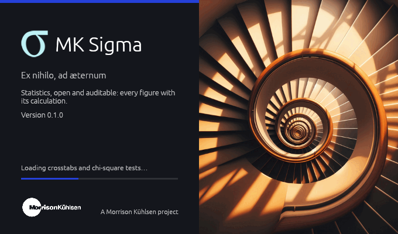
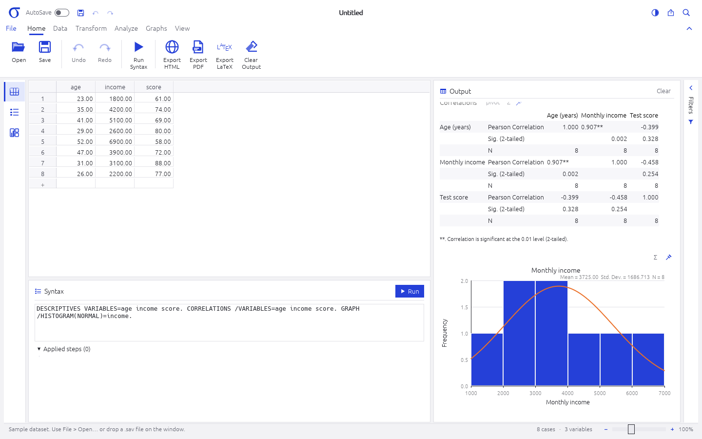
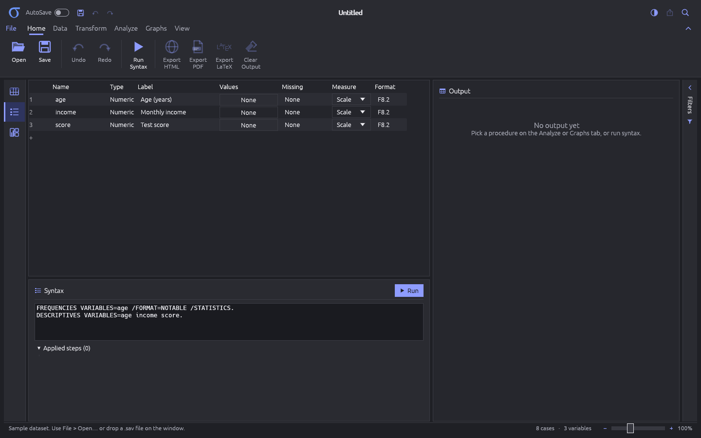

<h1 align="center">MK Sigma</h1>

<p align="center">
  <b>Statistics and dashboards: an open-source, clean-room statistics package with interactive dashboards, in pure Rust.</b>
</p>

<p align="center">
  One workflow, end to end and reproducible: get data in, prepare it, analyse it, publish it.
  Every step is syntax, so analyses can be rerun, reviewed and driven by agents. It runs
  natively on Linux, Windows, macOS and BSD, and later on the web via WebAssembly.
</p>

<p align="center">
  
  
  
  
  <br>
  
  
  
  
  
</p>

<br>

<p align="center">
  
  <br><sub><b>The splash screen</b>, shown while the program loads.</sub>
</p>

<p align="center">
  <a href="#a-look-around">A look around</a> ·
  <a href="#why-mk-sigma">Why MK Sigma</a> ·
  <a href="#what-it-does-today">What it does today</a> ·
  <a href="#quick-start">Quick start</a> ·
  <a href="#for-agents-cli-and-mcp">For agents</a> ·
  <a href="#architecture">Architecture</a> ·
  <a href="#license-and-credits">License and credits</a>
</p>

## A look around

<table>
<tr>
<td width="50%" valign="top"><p align="center"><sub><b>Syntax and the Output Viewer.</b> Procedures as syntax; pivot-style tables with significance flags, and charts.</sub></p></td>
<td width="50%" valign="top"><p align="center"><sub><b>Dark mode and Variable View.</b> The dictionary: labels, value labels, missing values, measures and formats.</sub></p></td>
</tr>
</table>

## Why MK Sigma

- **The whole workflow.** Get data in (`.sav`, CSV, `.xlsx`, later databases and Parquet), prepare
  it (every transformation a recorded, replayable step), analyse it (Data
  View and Variable View, command syntax, statistical procedures, the Output Viewer), and
  publish it (cross-filtered dashboards, exported as a self-contained interactive page).
- **Numerical parity.** Procedures land with tests against independently computed values,
  with results checked against scipy and statsmodels.
- **Reproducible and auditable.** Every edit and every step is syntax, with undo, so an
  analysis can be rerun, reviewed and explained, down to the calculation by hand (Σ).
- **Agent-native.** The CLI and an MCP server reach the same engine as the window.
- **Clean-room and open.** No GPL code; licensed MIT OR Apache-2.0.

## What it does today

> Early days. Today it reads and writes `.sav` files, reads CSV and other delimited text, edits
> data and the dictionary (every edit recorded as syntax, with undo), transforms data with
> `COMPUTE`, `IF`, `RECODE` and `SELECT IF`, and runs `DESCRIPTIVES`, `FREQUENCIES`, `CROSSTABS`
> (χ², Fisher), `T-TEST`, `ONEWAY`, post hoc tests, `CORRELATIONS`, `REGRESSION`,
> `LOGISTIC REGRESSION`, `NPAR TESTS` and `DISPLAY DICTIONARY`, with results checked against
> scipy and statsmodels; see [`docs/roadmap.md`](docs/roadmap.md).

## Quick start

```sh
cargo run -p mksigma                                                        # desktop app, sample data
cargo run -p mksigma -- data.sav                                            # or File ▸ Open, or drop a file
cargo run -p mksigma-cli -- run 'DESCRIPTIVES VARIABLES=age income score.'  # sample data
cargo run -p mksigma-cli -- run --in data.sav 'DISPLAY DICTIONARY.'
cargo run -p mksigma-cli -- run --in data.csv 'FREQUENCIES region.'         # read with GET DATA
cargo run -p mksigma-cli -- run --in data.sav --out fixed.sav "VARIABLE LABELS q1 'Satisfaction'."
cargo run -p mksigma-cli -- run --in data.sav --html report.html "GRAPH /HISTOGRAM(NORMAL)=x."
cargo test
```

Offscreen screenshots, with no window and nothing captured from the desktop:

```sh
cargo run -p mksigma-ui-egui --example snapshot -- --in data.sav out.png
cargo run -p mksigma-ui-egui --example snapshot -- --splash splash.png
```

## For agents: CLI and MCP

The CLI runs syntax against a file or the sample data and writes `.sav`, HTML reports and more;
`apps/mksigma-mcp` serves the same engine to agents over MCP. Every step an agent takes is
syntax, so it can be read back, rerun and reviewed.

## Architecture

| Crate                                                  | Layer | What it holds                                                           |
|--------------------------------------------------------|-------|-------------------------------------------------------------------------|
| `crates/core`                                          | L0    | Dataset, variables, values, missing values                              |
| `crates/output`                                        | L0    | Output items: tables, text, warnings                                    |
| `crates/syntax`                                        | L1    | Command syntax lexer and parser                                         |
| `crates/sav`                                           | L1    | `.sav` / `.zsav` reader and writer                                      |
| `crates/csv`                                           | L1    | Delimited text reader (`GET DATA /TYPE=TXT`)                            |
| `crates/stats`                                         | L1    | Statistical procedures                                                  |
| `crates/engine`                                        | L2    | `Session`: runs commands, collects output                               |
| `crates/ui-egui`                                       | L3    | egui frontend (swappable)                                               |
| `crates/web`                                           | L3    | Interactive dashboard pages: the engine as WebAssembly in one HTML file |
| `apps/mksigma`, `apps/mksigma-cli`, `apps/mksigma-mcp` | L4    | Desktop app, CLI and MCP server for agents                              |

- **Details:** [`docs/architecture.md`](docs/architecture.md)
- **Contributor and agent rules:** [`AGENTS.md`](AGENTS.md)
- **Bundled assets:** each one is listed with its terms in [`ATTRIBUTION.md`](ATTRIBUTION.md)

## License and credits

MK Sigma is dual-licensed under [MIT](LICENSE-MIT) or [Apache-2.0](LICENSE-APACHE), at your option.
The Morrison Kühlsen brand assets (the σ mark, the wordmark and the splash artwork) are used with
their owner's permission and are not covered by the code's licences; see
[`ATTRIBUTION.md`](ATTRIBUTION.md).

A Morrison Kühlsen project.
